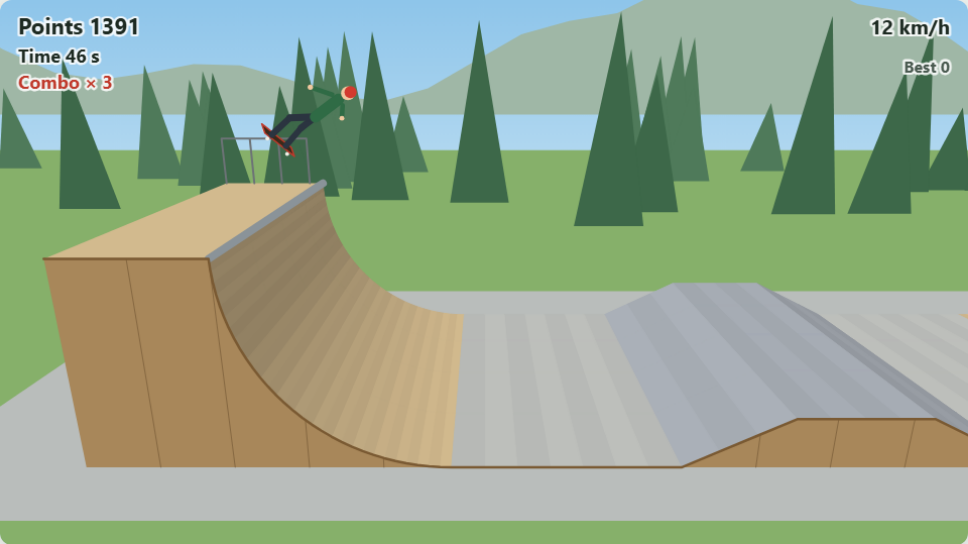

# Skateboard Halfpipe

A small 3D skate game on canvas with three parks: a wooden halfpipe, a concrete street park with a rail and a ledge, and a BMX park in a scrapyard. Ride a skateboard, a stunt scooter or a BMX, pump for speed, fly over the coping and land spins, kickflips, tailwhips, barspins and grabs. Play 60-second sessions or free ride without a clock.

**[Play it in the browser](https://locorida.github.io/skateboard-halfpipe/)** · English and German · keyboard and touch



## Features

- **3D without a library.** About 1100 lines of plain JavaScript: a small perspective projection, a painter's algorithm for the ramp surfaces and simple flat shading. The camera follows the rider and rises with big airs. No WebGL, no images, no build step.
- **Real pumping.** Speed doesn't come from a button. Crouch while riding down a wall, stand up in the bottom curve, and the timing decides how much speed you gain. Staying crouched uphill costs speed, so mashing ↓ doesn't work.
- **Physics in metres.** The rider moves along the ramp profile (3.2 m transitions, a funbox in the middle), flies ballistically after an ollie and goes straight up over the coping. Gravity, rolling resistance and drag are real; landings are a bit forgiving, like bending your knees.
- **Street park with grinds.** Ollie onto the rail or the ledge: straight for a 50-50 (5-0 on the ledge), turned 90° for a boardslide, feeble or grind on the scooter. You never land perfectly centred, so you steer with ← → to keep your balance, then roll off the end or ollie out.
- **Banners, graffiti and a crowd.** Made-up skate brands on a fence behind the halfpipe and on the brick wall of the street park, graffiti on the quarter pipes and the funbox, a few marker tags on the wooden halfpipe. A mountain bike leans against the halfpipe and three people watch from its decks. In the street park a few skaters watch from the wall: they clap after a trick, throw their arms up for big ones and hold their heads after a bail, and a black and white dog trots around, wags its tail and barks.
- **BMX everywhere.** The BMX works in every park: barspin on ↑, tabletop on ↓, double peg grinds on the rail, and on flat ground you pedal (pedalling alone never gets you over the coping, you still have to pump).
- **BMX park.** A small halfpipe in a scrapyard: tyre stacks to bunny hop and a rusty scrap car between a kicker and a landing ramp. Hop at the lip to fly over it; touch the car or the tyres and you crash. Wrecks are piled up behind a corrugated fence. Only the BMX is allowed here.
- **Free ride.** No clock, ride as long as you like. Points still count; the best score is only kept for 60-second sessions.
- **Tricks and combos.** Spins in steps of 180°, kickflips (skateboard) or tailwhips (scooter), grabs. Let go of the spin keys and the rider straightens up by themselves (up to about 60° off, like shuffling your feet after a sketchy landing); landings forgive 50°, and a flip only has to be 70 % done. Tricks in a row build up a combo up to ×5.
- **Accessible where it can be.** Keyboard controls, focusable canvas, on-screen buttons on touch devices, and an `aria-live` region that announces tricks, bails and the final score. Light and dark page theme.
- **Best score** saved in `localStorage` (optional; the game works without it).

## Controls

| Action | Keyboard | Touch |
|---|---|---|
| Drop in / ollie | Space | Tap the game or *Jump* |
| Pump (hold riding down, release at the bottom) | ↓ or S | ▼ |
| Spin in the air | ← → (A D) | ⟲ ⟳ |
| Kickflip / tailwhip / barspin | ↑ or W | ▲ |
| Grab / tabletop | hold ↓ in the air | ▼ |
| Push on flat ground (BMX: pedal, against the direction: brake) | ← → | ⟲ ⟳ |
| Bunny hop over tyres and the car (BMX park) | Space | *Jump* |
| Keep balance on a rail | ← → | ⟲ ⟳ |

## Tested balance

`npm test` runs `sim/balance.js`: bots play the real game code (loaded with a stubbed DOM) for full sessions, with different play styles and human-like timing errors, and the run fails if the game doesn't behave as intended (17 checks, for example: pedalling a BMX alone never reaches the coping, riding through the BMX park without hopping only crashes, free ride never ends):

```
idle            first air over coping    – | max height 0.0 m | score     0 | bails 0
holds down      first air over coping    – | max height 0.0 m | score     0 | bails 0
pumps, exact    first air over coping  3.3 s | max height 2.5 m | score  2149 | bails 0
pumps, ±0.2 s   first air over coping  3.4 s | max height 2.5 m | score  1869 | bails 0
tricks, good    first air over coping  3.4 s | max height 2.5 m | score 22531 | bails 0
tricks, sloppy  first air over coping  3.3 s | max height 2.5 m | score 12590 | bails 2
street, airs only   first air over coping  4.1 s | grinds  0 | score  1350 | bails 0
street, grinds      first air over coping  4.2 s | grinds 10 | score 19171 | bails 0
street, no balance  first air over coping  8.7 s | grinds  3 | score  1976 | bails 3
bmx, pumps          first air over coping  3.3 s | score 22583 | bails 0
bmx, pedals only    first air over coping    – | score     0 | bails 0
bmx park, rides     car jumps  0 | all jumps  0 | score     0 | bails 21
bmx park, hops      car jumps 11 | all jumps 33 | score 41838 | bails 0
bmx park, sloppy    car jumps 10 | all jumps 29 | score 24868 | bails 3
```

The simulation found the main tuning problem: the funbox used to launch riders automatically and ate about a third of their speed on every pass, so pumping never paid off. Now you roll over it unless you ollie.

Requires Node 18 or newer, no `npm install` needed. It runs on every push via GitHub Actions and takes about a second.

## Run locally

Open `index.html` in a browser. `?lang=en` or `?lang=de` picks the language (otherwise the browser language decides).

## Embedding

The game needs a `<canvas id="halfpipe" width="960" height="540">` and optionally a status element `#halfpipe-status` with `aria-live`. Texts can be passed as JSON in `data-texts` on the canvas (German is the default). Load `halfpipe.js`; `window.Halfpipe.setVehicle('skate' | 'scooter' | 'bmx')` switches the ride, `window.Halfpipe.setPark('pipe' | 'street' | 'bmx')` the park (each park keeps its own best score; the BMX park forces the BMX, see `Halfpipe.only` and `Halfpipe.vehicle`), `window.Halfpipe.setFreeRide(true)` turns the clock off and `window.Halfpipe.press(key, down)` wires up your own touch buttons. See `index.html`.

## License

[MIT](LICENSE)
